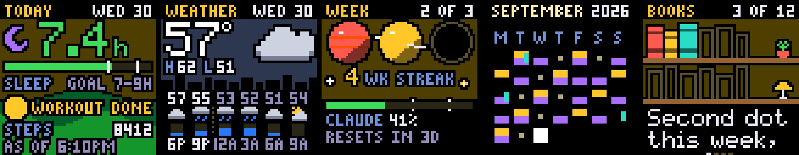
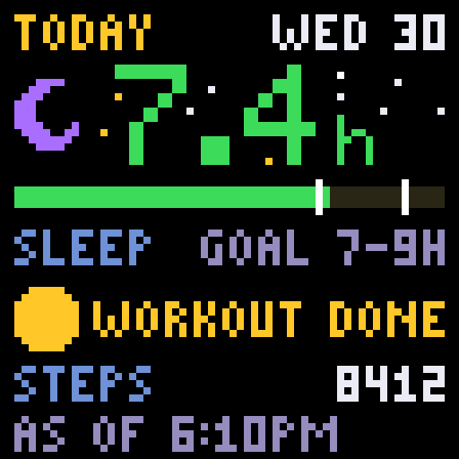
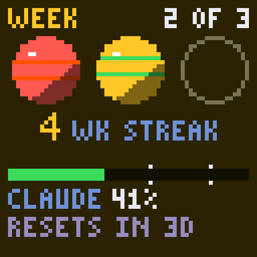
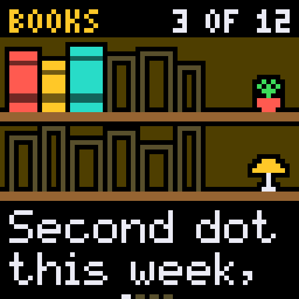
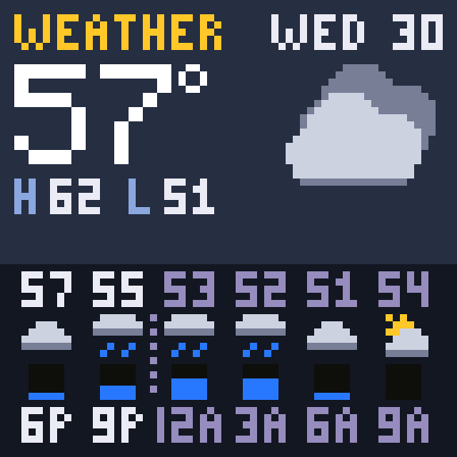
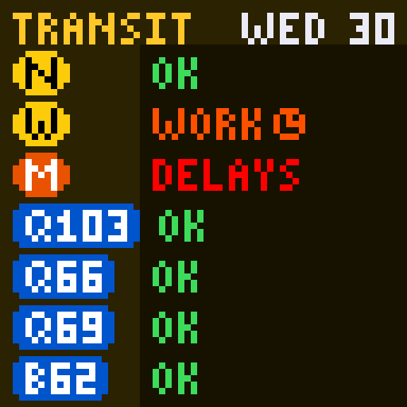
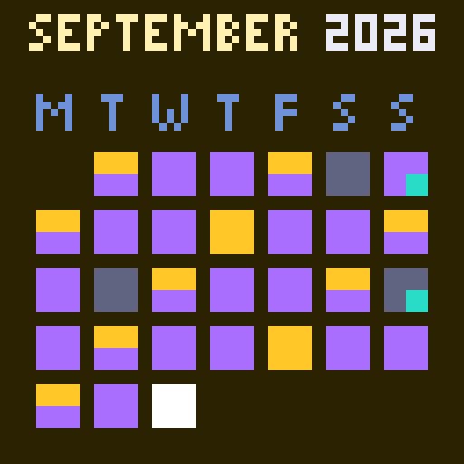
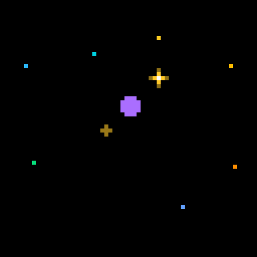
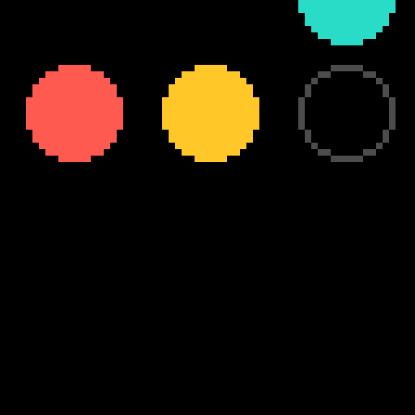

# Life Dashboard

### My first adventure into the realm of Hardware!

## Stack

I got a Divoom Pixoo 64 (LED display) and coded up a dashboard of various rotating wellbeing metrics. I'll get a Raspberry Pi one day but currently it depends on my MacBook being on.

- Sleep and workout data that I linked with the iOS Health Auto Export app via REST API
- Delays for the various bus and train lines I pull from the MTA alerts page
- Book progress within a year via my public Goodreads RSS feed
- Daily weather
- A monthly feature synthesizing some aspect(s) of data collection
## Screens

| Today | Week | Books |
|---|---|---|
|  |  |  |

| Weather | Transit | Month |
|---|---|---|
|  |  |  |

Small wins and a completed week get a short celebration, sent to the panel as a sequence of stills:

| Workout win | Sleep win | Week done |
|---|---|---|
|  |  |  |

- Python 3.12, uv, FastAPI, SQLite (stdlib, hand-written migrations), APScheduler, httpx, Pillow, pytest, ruff.
- Anthropic SDK for the daily line, the month feature, and a heart-rate "coach" that can credit a sustained effort the feed missed. Model ids and the monthly cap live in `config.toml`.
